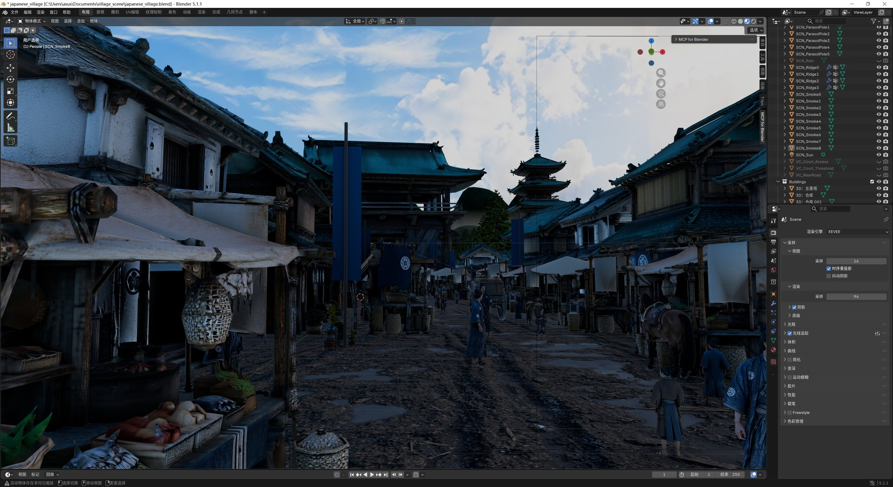
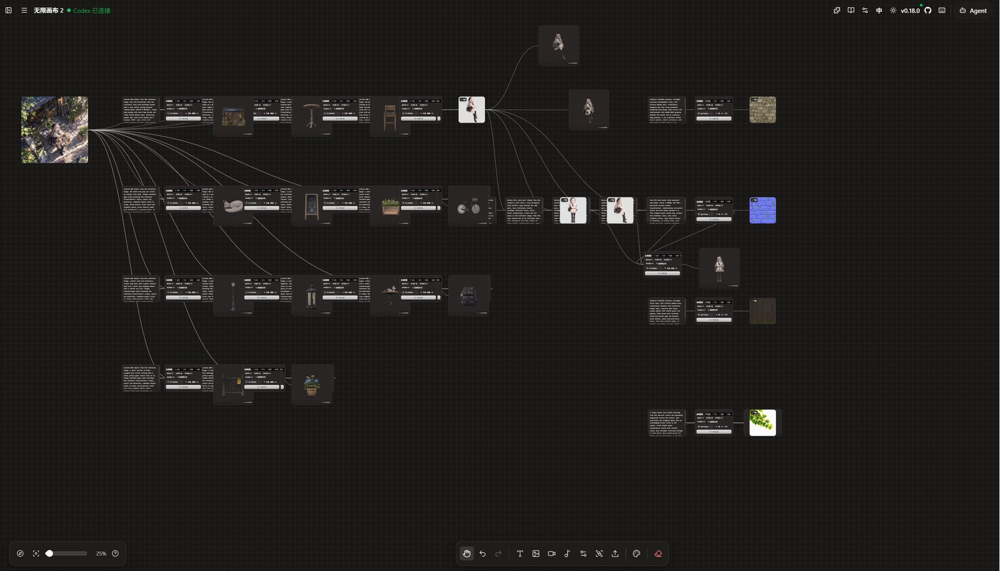
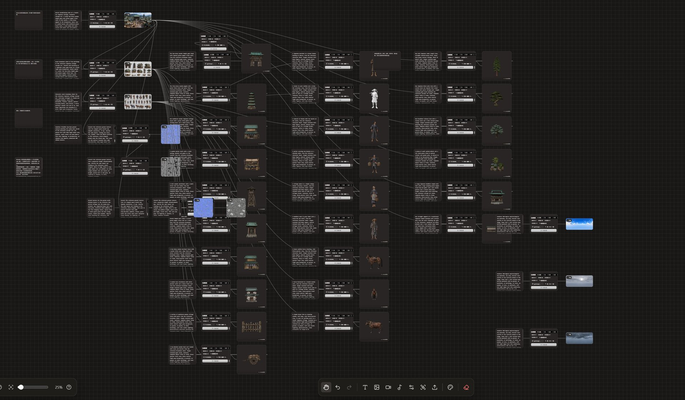
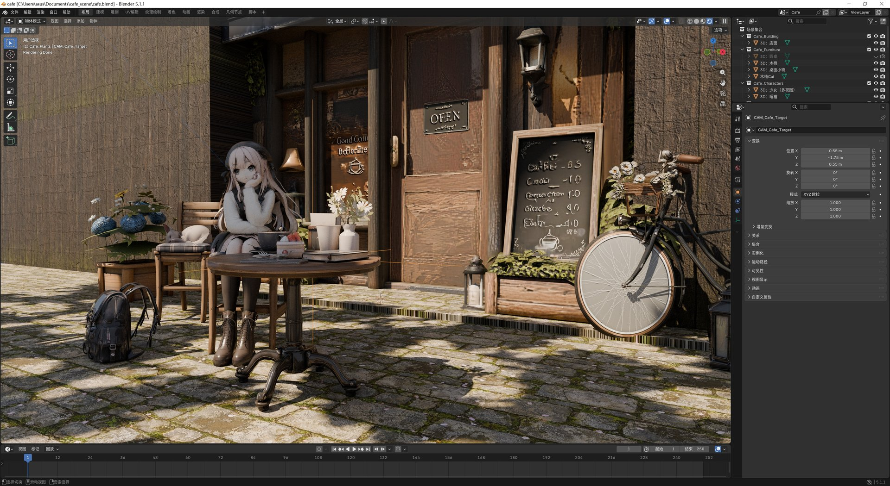

<p align="center">
  
</p>

<h1 align="center">无限画布 (infinite-canvas)</h1>

<p align="center">
  <a href="https://github.com/basketikun/infinite-canvas"></a>
  <a href="https://github.com/basketikun/infinite-canvas/tags"></a>
  <a href="LICENSE"></a>
  <a href="https://vite.dev/"></a>
  <a href="https://reactrouter.com/"></a>
</p>

<p align="center">
  <a href="docs/content/docs/overview/quick-start.mdx">快速开始</a> · <a href="docs/content/docs/overview/features.mdx">功能介绍</a> · <a href="docs/content/docs/overview/render.mdx">Render 部署</a> · <a href="docs/content/docs/overview/docker.mdx">Docker 部署</a> · <a href="docs/content/docs/canvas/canvas-node-manual.mdx">画布节点操作手册</a> · <a href="docs/content/docs/canvas/canvas-shortcuts.mdx">画布快捷键</a> · <a href="SECURITY.md">漏洞提交</a> · <a href="docs/content/docs/progress/todo.mdx">待办事项</a> · <a href="canvas-agent/README.md">本地 Canvas Agent</a> · <a href="plugins/infinite-canvas">Codex app 插件</a>
</p>

无限画布是一款面向图片创作的开源工作台。它把画布编排、AI 图片生成、参考图编辑、3D 生成、对话助手、提示词库和素材沉淀放在同一个界面里，适合用来探索视觉方案并连续迭代生成结果。

> [!CAUTION]
> 项目目前处于开发阶段，不保证历史数据兼容。各种本地存储格式都可能直接调整，欢迎关注后续更新。
>
> 如果你需要稳定维护自己的分支，建议自行 fork 后独立开发。二次开发与 PR 请保留原作者信息和前端页面标识。

## 核心功能

- 无限画布：多画布项目、节点拖拽缩放、连线、小地图、撤销重做、导入导出。
- AI 创作：浏览器前台直连你配置的 OpenAI 兼容接口，支持文生图、图生图、参考图编辑、文本问答、音频和视频生成。
- 3D 生成：接入 Tripo，支持文生 3D、图生 3D、多视图生 3D，节点内可拖拽旋转查看模型，并提供一整套 3D 后处理操作。
- 本机 3D 软件联动：已生成的模型可直接导入本机 Blender，或唤起 Bambu Studio 打开 3MF。
- 画布助手：围绕选中节点和上游节点对话、生图，并把结果插回画布。
- 本地 Agent：通过本机 Canvas Agent 连接 Codex / Claude Code，让 Agent 通过 MCP 操作当前画布。
- Codex App 插件：提供 Codex app 插件，安装后会自动注册 MCP 并尝试拉起本地 Agent。
- 插件系统：支持通过 URL 动态安装 / 启用 / 更新 / 卸载远程节点插件，并提供 TypeScript SDK 自行开发画布节点插件。
- 自定义接口调用：可自定义生图 / 视频接口的调用方式，灵活适配各类中转站与自建服务。
- 提示词库：内置 7 个开源提示词来源并支持自定义标准 JSON 来源，由浏览器前端直连并缓存到 IndexedDB。

完整功能说明见 [功能介绍](docs/content/docs/overview/features.mdx)。

## 3D 与 Tripo

3D 能力由 Tripo 提供，配置和使用要点如下，完整说明见 [画布节点操作手册](docs/content/docs/canvas/canvas-node-manual.mdx)。

### 配置

- 在配置弹窗新增渠道，`apiFormat` 选择 **Tripo**，并填入该区域的 API Key。
- Tripo 分国内版（`openapi.tripo3d.com`）和海外版（`openapi.tripo3d.ai`）两个独立区域，选择 Tripo 后渠道编辑器会出现区域切换；两个区域是独立账号，需各自填写 Key。
- API Key 购买入口：[国内版](https://developers.tripo3d.com/zh) · [海外版](https://developers.tripo3d.ai/zh)。
- 必须开启 **本地代理**：Tripo 的 `/v3` 接口不返回 CORS 头，浏览器无法直连。
- Tripo 渠道同时提供 3D 与图片生成能力，图片模型是它自己的一套（`seedream`、`banana`、`chat_image` 三个系列）。

### 生成

- 工具栏和连线创建菜单都可以新建 3D 节点，节点内使用可拖拽旋转、滚轮缩放的查看器展示 glb。
- 空 3D 节点输入提示词走文生 3D；连接 1 个图片节点走图生 3D；连接 2–4 个图片节点走多视图生 3D，节点左侧的四个视角接点（正面 / 左侧 / 背面 / 右侧）用来指定每张图的视角。
- 3D 设置包含贴图、PBR 材质、贴图质量和面数上限；面数上限留空为自动。
- Tripo 生成是异步任务：任务 ID 写入节点，刷新页面会自动继续查询。生成成功后 glb 和预览图会立即下载到浏览器本地存储，因为 Tripo 的签名地址一天后失效。

### 3D 操作

悬停已有模型的 3D 节点打开「3D 操作」：重新贴图、自动绑骨、套用动画、减面、分割部件、网格补全和转换格式。除转换写回原节点外，其余操作都会在右侧生成新的 3D 节点并连线。

- 自动绑骨会先跑 Tripo 免费的可绑骨检测，模型不可绑骨时直接提示，不消耗 credits。
- 套用动画只能接在本画布绑过骨的节点后面，网格补全只能接在本画布分割过的节点后面。
- 转换格式支持 FBX、GLTF、USDZ、OBJ、STL、3MF；产物留在原节点上，可从菜单下载。

### 导入本机软件

- **导入 Blender**：经 Tripo Bridge 插件的 `ws://127.0.0.1:60600` 把已存文件发给本机 Blender。需要用 `http://localhost` 打开画布，HTTPS 页面不允许连接本机 ws；3MF 不会发给 Blender。
- **打开 Bambu Studio**：用 `bambustudio://open?file=` 唤起本机 Bambu Studio 打开 3MF。节点还不是 3MF 时会自动转换并写回（消耗 credits）；转换时记下的 Tripo 地址仍有效就直接用它，否则由本机 Canvas Agent 临时托管该文件。

多选或选中含 3D 的组可以一起操作。这两项都是画布 UI 操作，MCP 没有对应工具。

### Agent 生成 3D

Canvas Agent 把 3D 注册为一等生成工具 `canvas_generate_model3d`：仅有提示词走文生 3D，带上已有图片节点 ID 则走图生 3D 或多视图生 3D。

## 快速开始

AI API Key、Base URL、画布、素材和生成记录默认保存在浏览器本地。

### 本地开发

```bash
git clone git@github.com:basketikun/infinite-canvas.git
cd infinite-canvas
cd web
bun install
bun run dev
```

### Docker 运行

```bash
git clone git@github.com:basketikun/infinite-canvas.git
cd infinite-canvas
docker compose up -d
```

运行后默认端口3000，可访问 `http://localhost:3000`。

首次打开后进入右上角配置，填入自己的 OpenAI 兼容 `Base URL` 和 `API Key`；需要 3D 时按上面的说明添加 Tripo 渠道。

如果默认的OpenAI接口调用方式与您的API不同，可自定义生图/视频脚本调用。

## 效果展示

<table width="100%">
  <tr>
    <td width="50%"></td>
    <td width="50%"></td>
  </tr>
  <tr>
    <td colspan="2"></td>
  </tr>
  <tr>
    <td width="50%"></td>
    <td width="50%"></td>
  </tr>
</table>

## 原项目与开源协议

本项目源自 [basketikun/infinite-canvas](https://github.com/basketikun/infinite-canvas)。

本项目使用 [MIT License](LICENSE)。任何人都可以免费使用、复制、修改、分发、再授权和商业使用本项目，也可以用于闭源产品。
