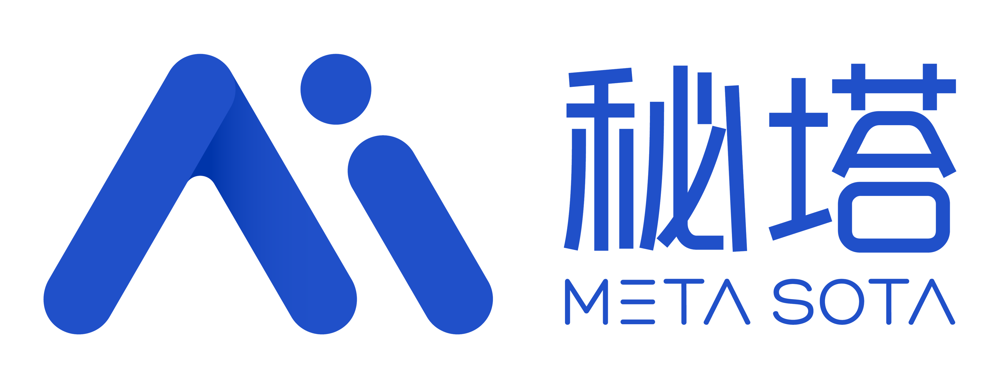
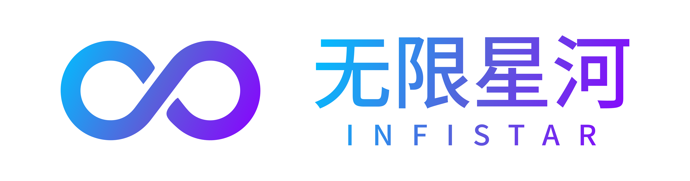

<p align="center">
  
</p>

<h1 align="center">无限画布 (infinite-canvas)</h1>

<p align="center">
  <a href="https://linux.do/"></a>
  <a href="https://render.com/deploy?repo=https://github.com/basketikun/infinite-canvas"></a>
  <a href="https://github.com/basketikun/infinite-canvas"></a>
  <a href="https://github.com/basketikun/infinite-canvas/tags"></a>
  <a href="LICENSE"></a>
  <a href="https://vite.dev/"></a>
  <a href="https://reactrouter.com/"></a>
</p>

<p align="center">
<a href="https://trendshift.io/repositories/50077?utm_source=repository-badge&amp;utm_medium=badge&amp;utm_campaign=badge-repository-50077" target="_blank" rel="noopener noreferrer"></a>
</p>

<p align="center">
  <a href="apps/docs/content/docs/overview/quick-start.mdx">快速开始</a> · <a href="apps/docs/content/docs/overview/features.mdx">功能介绍</a> · <a href="apps/docs/content/docs/overview/render.mdx">Render 部署</a> · <a href="apps/docs/content/docs/overview/docker.mdx">Docker 部署</a> · <a href="apps/docs/content/docs/canvas/canvas-node-manual.mdx">画布节点操作手册</a> · <a href="apps/docs/content/docs/canvas/canvas-shortcuts.mdx">画布快捷键</a> · <a href="SECURITY.md">漏洞提交</a> · <a href="apps/docs/content/docs/progress/todo.mdx">待办事项</a> · <a href="apps/cli/README.md">CLI 本地版</a> · <a href="agent-plugins/infinite-canvas">Codex / ZCode 插件</a>
</p>

无限画布是一款面向图片创作的开源工作台。它把画布编排、AI 图片生成、参考图编辑、对话助手、提示词库和素材沉淀放在同一个界面里，适合用来探索视觉方案并连续迭代图片结果。

> [!CAUTION]
> 项目目前处于开发阶段，不保证历史数据兼容。各种本地存储格式都可能直接调整，欢迎关注后续更新。
>
> 如果你需要稳定维护自己的分支，建议自行 fork 后独立开发。二次开发与 PR 请保留原作者信息和前端页面标识。

## 赞助商

<table>
  <tr>
    <td width="190" align="center">
      <a href="https://kunrouai.com/?utm_source=infinite-canvas" target="_blank" rel="noopener noreferrer"></a>
    </td>
    <td>
      <a href="https://kunrouai.com/?utm_source=infinite-canvas" target="_blank" rel="noopener noreferrer">坤肉AI</a> 是一站式 AI 视觉创作平台，集 AI 生图、视频生成、多人协作画布及 Agent/MCP 连接于一体，适合个人创作与团队协作，同时面向企业提供源码出售及私有化部署服务，欢迎企业咨询合作！另有 <a href="https://api.kunrouai.com/?utm_source=infinite-canvas" target="_blank" rel="noopener noreferrer">API 开放平台</a>，提供丰富的 AI 模型 API 接口，支持快速接入与集成，欢迎开发者及企业对接合作！
    </td>
  </tr>
  <tr>
    <td width="190" align="center">
      <a href="https://go.apimart.ai/gh-infinite-canvas" target="_blank" rel="noopener noreferrer"></a>
    </td>
    <td>
      感谢 <strong><a href="https://go.apimart.ai/gh-infinite-canvas" target="_blank" rel="noopener noreferrer">APIMart</a></strong> 赞助了本项目！<strong><a href="https://go.apimart.ai/gh-infinite-canvas" target="_blank" rel="noopener noreferrer">APIMart</a></strong> 是专注 AI 图片/视频生成的低价 API 平台，GPT-Image-2 低至 <strong>$0.006/张</strong>，<strong>1 美元</strong>可出图 <strong>160+ 张</strong>。图片、视频一套异步 API 通吃，提交任务拿 ID、回调取结果，跑批万张不超时、换模型不改代码。按量付费、无月费，通过 <strong><a href="https://go.apimart.ai/gh-infinite-canvas" target="_blank" rel="noopener noreferrer">此注册链接</a></strong> 注册即可开用。
    </td>
  </tr>
  <tr>
    <td width="190" align="center">
      <a href="https://www.atlascloud.ai/zh?utm_source=github&utm_medium=link&utm_campaign=infinite-canvas" target="_blank" rel="noopener noreferrer"></a>
    </td>
    <td>
      <a href="https://www.atlascloud.ai/zh?utm_source=github&utm_medium=link&utm_campaign=infinite-canvas" target="_blank" rel="noopener noreferrer">Atlas Cloud</a> is a full-modal AI inference platform that gives developers a single AI API to access video generation, image generation, and LLM APIs. Instead of managing multiple vendor integrations, you connect once and get unified access to 300+ curated models across all modalities. Check out <a href="https://www.atlascloud.ai/console/coding-plan" target="_blank" rel="noopener noreferrer">Atlas Cloud's new coding plan promotion</a> for more budget-friendly API access.
    </td>
  </tr>
  <tr>
    <td width="190" align="center">
      <a href="https://metaso.cn/minimax-h3/?s=inf" target="_blank" rel="noopener noreferrer"></a>
    </td>
    <td>
      <strong>MiniMax H3 视频生成 API｜秘塔科技</strong> 秘塔科技提供高性价比的 MiniMax H3 视频生成服务：<strong>768P 仅 0.09 元/秒，2K 仅 0.15 元/秒</strong>。支持原生 2K、音画同步，API 兼容 <strong>OpenAI 协议</strong>，同时支持 <strong>ComfyUI</strong>，无需自行部署 GPU。 🎁 通过 <a href="https://metaso.cn/minimax-h3/?s=inf" target="_blank" rel="noopener noreferrer">无限画布专属链接注册</a>，即可领取赠送额度及专属优惠。
    </td>
  </tr>
  <tr>
    <td width="190" align="center">
      <a href="https://88api.ai/sign-up?aff=zbs9" target="_blank" rel="noopener noreferrer"></a>
    </td>
    <td>
      <strong>88API｜无限画布 深度优化分支</strong>
      让主流模型能力结合得更紧密，内置海量提示词、满参满血！
      🎨&nbsp;支持 GPT-Image、Gemini、Grok 等图片模型；原生 124K 全部同价！
      🎬&nbsp;支持 Seedance、H3、Kling、Wan、Grok、Veo、omni 等视频模型；
      🎙️&nbsp;支持 Whisper、TTS、STT 等语音能力。
      从文案、出图、改图，到视频生成与配音，一张画布串联完整创作链路。不只是模型聚合，更让不同模型在同一工作流中真正协同。👉&nbsp;立即体验 🎁&nbsp;通过 <a href="https://88api.ai/sign-up?aff=zbs9" target="_blank" rel="noopener noreferrer">无限画布专属链接注册</a>，即可赠送额度及专属优惠。
    </td>
  </tr>
  <tr>
    <td width="190" align="center">
      <a href="https://www.infistar.cc/register?aff=4X3V9NA9&ref_source=link" target="_blank" rel="noopener noreferrer"></a>
    </td>
    <td>
      <strong>无限画布 × Infistar.ai 无限星河｜内置原生画布 · 全能多模态 API</strong> 💡 原生集成，即点即用： Infistar.ai 已原生上架无限画布！同时提供低至官方 1 折的稳定 API 中转服务，模型倍率与调用明细全程透明。 🎨 多模态生图/生视频： 完美适配 Seedance、FLUX、Midjourney、Sora、Runway、Luma、可灵（Kling）等顶级图片与视频大模型。 🧠 全系语言模型： 覆盖 OpenAI、Claude、Gemini、Grok、DeepSeek、Qwen、GLM 等国内外主流模型，兼容 OpenAI 标准接口。 ⚡ 动态调度： 多路供应保障高可用，拒绝断连。 🎁 专属福利： 通过 <a href="https://infistar.ai/register?aff=4X3V9NA9&ref_source=link" target="_blank" rel="noopener noreferrer">专属链接</a> 注册，立享赠送额度/专属折扣/首充权益！
    </td>
  </tr>
  <tr>
    <td width="190" align="center">
      <a href="https://www.compshare.cn/video-studio?ytag=GPU_YY_YX_git_infinite-canvas" target="_blank" rel="noopener noreferrer"></a>
    </td>
    <td>
      <strong>H3 视频生成 API｜优云智算</strong> 优云智算提供高性价比的 H3 视频生成服务，涵盖<strong>文生视频、首尾帧及全能参考</strong>。支持最长 <strong>30s</strong> 视频、<strong>4K</strong> 画质，<strong>768P 仅 0.08 元/秒</strong>。支持 API 调用、企业高并发、自助开票。 🎁 通过 <a href="https://www.compshare.cn/video-studio?ytag=GPU_YY_YX_git_infinite-canvas" target="_blank" rel="noopener noreferrer">无限画布专属链接注册</a>，即可领取免费赠送额度。
    </td>
  </tr>
  <tr>
    <td width="190" align="center">
      <a href="https://www.packyapi.com/register?aff=34VV" target="_blank" rel="noopener noreferrer"></a>
    </td>
    <td>
      <strong>无限画布 × PackyCode｜稳定高效的 API 中转服务商</strong>
      💡&nbsp;PackyCode 是一家稳定、高效的 API 中转服务商，提供 Claude Code、Codex、Gemini 等多种中转服务，让 AI 编程成为真正的生产力工具。
      ⚡&nbsp;稳定高效： 具备自动故障转移、智能路由和无限并发等多种功能，保障调用稳定可靠。
      🎁&nbsp;专属福利： 通过 <a href="https://www.packyapi.com/register?aff=34VV" target="_blank" rel="noopener noreferrer">专属链接</a> 注册，立即开始使用！
    </td>
  </tr>
  <tr>
    <td width="190" align="center">
      <a href="https://heyroute.ai/basketikun" target="_blank" rel="noopener noreferrer"></a>
    </td>
    <td>
      <strong>无限画布 × HeyRoute｜全能多模态 API 服务商</strong>
      💡&nbsp;HeyRoute 深度接入无限画布，将创意构思、图片生成、视频制作与内容开发融为一体，让每个灵感都能快速落地。
      🎨&nbsp;多模态创作能力： 支持 AI 生图、生视频、图像编辑及内容生成，兼容 Seedance、MiniMax-H3、Image-2、Grok Video、Flux Klein、Gemini 等主流模型。
      🧠&nbsp;丰富模型生态： 覆盖 OpenAI、Claude、Gemini、Grok、DeepSeek、Qwen、GLM 等语言模型，并兼容 OpenAI 标准接口。
      ⚡&nbsp;稳定高效调用： 支持多模型、多线路灵活调度，调用记录清晰透明，满足日常创作、应用开发与批量生产需求。
      🎁&nbsp;专属福利： 通过 <a href="https://heyroute.ai/basketikun">专属链接</a> 注册，即可领取新用户 15 美元试用额度！
    </td>
  </tr>
</table>

## 核心功能

- 无限画布：多画布项目、节点拖拽缩放、连线、小地图、撤销重做、导入导出。
- AI 创作：使用你配置的模型渠道，支持文生图、图生图、参考图编辑、文本问答、音频和视频生成。
- 画布助手：围绕选中节点和上游节点对话、生图，并把结果插回画布。
- MCP 画布工具：CLI 本地版向 Codex、Claude Code 等外部 Agent 开放画布操作；右侧聊天使用渠道文本模型直接调用同一套工具。
- Codex App 插件：安装后会自动注册 MCP 并启动本地版画布。
- 插件系统内置插件市场，可一键安装、更新和管理插件，也支持上传插件包。开发自己的工作台页面、导航、布局或画布节点，可从[最小插件模板](plugins/template/)开始。
- 自定义接口调用：可自定义生图 / 视频接口的调用方式，灵活适配各类中转站与自建服务。
- 提示词库：内置 7 个开源提示词来源并支持自定义标准 JSON 来源，由浏览器直连拉取并缓存在本地。

完整功能说明见 [功能介绍](apps/docs/content/docs/overview/features.mdx)。

如果你在为担心没有合适的生图API来发愁，可以查看该免费生图项目：[chatgpt2api](https://github.com/basketikun/chatgpt2api)

## 快速开始

项目提供两种运行方式：

- **CLI 本地版（推荐）**：功能完整，作品和渠道凭据保存在本机目录，支持插件命令行管理，并可通过 MCP 让 Codex、Claude Code 等 AI 助手操作画布。
- **纯 Web 版**：纯静态站点，数据保存在浏览器，不支持外部 AI 助手连接，适合部署静态站点或做二次开发。
- **桌面版**：用 Electron 窗口打开 CLI 本地版，功能与 CLI 相同，适合自行构建后分发。项目不提供桌面版安装包，需要自己构建。

### 本地启动

> CLI 本地版仅适用于个人在本机使用，请不要部署到服务器或开放给他人访问。本地版没有登录保护，开放后任何能访问的人都可以查看作品、使用你的模型密钥，并在这台电脑上运行代码。需要多人访问请二次开发或者部署纯 Web 版。

需要 Node.js 22 或更高版本：

```bash
npx -y @basketikun/infinite-canvas@latest serve --open
```

启动后打开终端显示的地址（默认 `http://localhost:17371`），作品默认保存在 `~/.infinite-canvas/workspace`，可用 `--data-dir` 指定其他目录。连接 AI 助手请在页面「设置 → Agent配置」中复制 MCP 配置。

### 本地开发

```bash
git clone git@github.com:basketikun/infinite-canvas.git
cd infinite-canvas
pnpm install --frozen-lockfile
pnpm dev --open
```

默认启动 CLI 本地工作台，支持源码热更新，无需先构建。桌面版使用 `pnpm dev:desktop`，与 CLI 共用工作区和插件；纯 Web 使用 `pnpm dev:web`。CLI 选项与数据目录见 [本地开发文档](apps/docs/content/docs/development/local-development.mdx)。

### 构建桌面版

```bash
pnpm install --frozen-lockfile
pnpm build:desktop
```

会为当前系统和架构打包应用到 `apps/desktop/dist/`，与 CLI 共用 `~/.infinite-canvas/workspace` 工作区。签名、安装程序和自动更新需要自行处理，详见 [桌面版说明](apps/desktop/README.md)。

### Docker 运行（纯 Web 版）

```bash
git clone git@github.com:basketikun/infinite-canvas.git
cd infinite-canvas
docker compose up -d
```

运行后默认端口3000，可访问 `http://localhost:3000`。

首次打开后进入右上角配置，填入自己的 OpenAI 兼容 `Base URL` 和 `API Key`。

如果默认的OpenAI接口调用方式与您的API不同，可自定义生图/视频脚本调用。

## 效果展示

<table width="100%">
  <tr>
    <td width="50%"></td>
    <td width="50%"></td>
  </tr>
  <tr>
    <td width="50%"></td>
    <td width="50%"></td>
  </tr>
  <tr>
    <td width="50%"></td>
    <td width="50%"></td>
  </tr>
  <tr>
    <td width="50%"></td>
    <td width="50%"></td>
  </tr>
</table>

## 联系方式

项目定制二次开发需求 / 生图 API 需求可联系。

邮箱：1844025705@qq.com · QQ：1844025705

## 赞助支持

本项目长期开放广告赞助合作，欢迎品牌 / 产品投放，你的支持是持续更新的动力！

有广告赞助意向请通过上方联系方式沟通。

## 社区支持

学 AI，上 L 站：[LinuxDO](https://linux.do/)

点击链接加入群聊【开源无限画布(2群)】：https://qm.qq.com/q/HRt2kUnYiG

## 开源协议

本项目使用 [MIT License](LICENSE)。任何人都可以免费使用、复制、修改、分发、再授权和商业使用本项目，也可以用于闭源产品。

## Star History

<a href="https://www.star-history.com/?repos=basketikun%2Finfinite-canvas&type=date&legend=top-left">
 <picture>
   <source media="(prefers-color-scheme: dark)" srcset="https://api.star-history.com/chart?repos=basketikun/infinite-canvas&type=date&theme=dark&legend=top-left" />
   <source media="(prefers-color-scheme: light)" srcset="https://api.star-history.com/chart?repos=basketikun/infinite-canvas&type=date&legend=top-left" />
   
 </picture>
</a>
